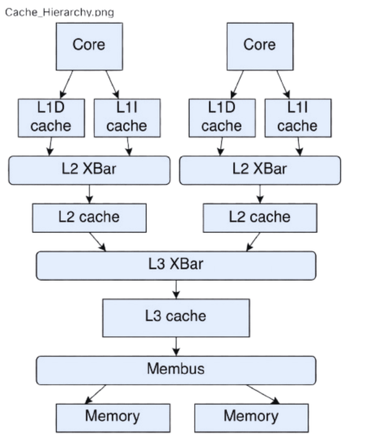

# ARM Cache Power Model

This project builds a configurable ARM gem5 system (O3, Minor, Timing or Atomic CPUs) with a private L1I/L1D, a private L2 and a shared L3, and attaches a McPAT-calibrated power model to the cores and caches. It is designed for ARM64 SE-mode simulations.

## What this project does

- Builds the hierarchy with a custom gem5 component in [src/three_level.py](src/three_level.py)
- Runs a user-specified ARM64 Linux binary through [src/main.py](src/main.py)
- Characterizes each core and cache with McPAT, then installs gem5 `MathExprPowerModel` objects so that gem5 reports dynamic and static power in `stats.txt`
- Extracts a one-row CSV of results ([src/extract_gem5_stats.py](src/extract_gem5_stats.py))
- Cross-checks gem5's numbers against a full McPAT evaluation ([src/validate_mcpat.py](src/validate_mcpat.py))

## Cache Hierarchy Block Diagram



## Project structure

All paths are relative to the project root.

- `src/main.py`: command-line entrypoint for launching gem5 simulations
- `src/three_level.py`: custom cache hierarchy
- `src/power/`: McPAT characterization, caching and the power-model builder
- `src/extract_gem5_stats.py`: turns `stats.txt` into a CSV row
- `src/validate_mcpat.py`: McPAT cross-check of a finished run
- `src/run_gem5.sh`: wrapper script
- `tests/`: unit, end-to-end and slow tests, plus the ARM64 test programs they run
- `power_cache/`: cached characterization results (created on demand, git-ignored)
- `tools/mcpat/mcpat`: suggested McPAT build location (git-ignored); point `MCPAT_BIN` at it

## Requirements

- gem5 25.1 with an ARM build
- McPAT, built from gem5's bundled sources into `tools/` (run from the project root):

  ```bash
  make -C $GEM5_ROOT/ext/mcpat BUILD_DIR=$PWD/tools -j8
  ```

  This produces `tools/mcpat/mcpat`. It is the AMD-refactored McPAT 0.8 that ships with gem5.

### Environment

The project has no built-in tool locations. Set these before running anything (paths are examples):

```bash
export GEM5_ROOT=/path/to/gem5                      # gem5 checkout
export GEM5_BIN=$GEM5_ROOT/build/ARM/gem5.opt       # gem5 ARM binary
export MCPAT_BIN=/path/to/project/tools/mcpat/mcpat # McPAT binary
export PYTHON=python3                               # interpreter for stats extraction
```

| Variable | Used by | If missing |
|---|---|---|
| `GEM5_ROOT` | `main.py` (O3 and MINOR core configs), McPAT regression tests | `main.py` errors for O3/MINOR unless `--gem5_root` is given |
| `GEM5_BIN` | `run_gem5.sh`, e2e tests | `run_gem5.sh` errors |
| `MCPAT_BIN` | `main.py`, `validate_mcpat.py`, `power.characterize` | they error unless `--mcpat_bin` is given |
| `PYTHON` | `run_gem5.sh` | `run_gem5.sh` errors |

`run_gem5.sh` checks all four before starting gem5, reports every missing or invalid one at once, and passes `GEM5_ROOT` and `MCPAT_BIN` to `main.py` explicitly. Tests that need a variable that is not set are skipped with a warning.
- A cross-compiler for ARM64 Linux binaries (`aarch64-linux-gnu-gcc` is recommended)
- A Python environment with `pytest` for the tests

## Build a sample ARM64 program

From the project root:

```bash
aarch64-linux-gnu-gcc -static -o tests/test_sample_arm64 tests/test_sample.c
```

If `aarch64-linux-gnu-gcc` is not available, try:

```bash
clang --target=aarch64-linux-gnu --sysroot=$AARCH64_SYSROOT -static -O2 \
  -o tests/test_sample_arm64 tests/test_sample.c
```

`$AARCH64_SYSROOT` is the directory holding your aarch64 Linux headers and libraries.

The multithreaded test binary `tests/threads_arm64` is gem5's `tests/test-progs/threads` program (source copied to `tests/threads.cpp`). To rebuild it, from the project root:

```bash
aarch64-linux-gnu-g++ -O2 -static -pthread \
  -o tests/threads_arm64 tests/threads.cpp
```

Run it with `--num_cores 2` (or more). It exercises cores that are clock-gated for part of the run.

## Run a simulation

From the project root:

```bash
$GEM5_BIN src/main.py \
  --binary tests/test_sample_arm64
```

Or use the wrapper, which also runs `extract_gem5_stats.py` afterwards and writes `<outdir>/filtered_stats.csv`:

```bash
bash src/run_gem5.sh --binary tests/test_sample_arm64 [benchmark args] [options]
```

The wrapper can be run from any directory; relative `--binary` and `--outdir` paths are taken relative to the current directory. It accepts `--outdir <dir>` (default `m5out`), passes it to gem5 as `-d`, and exits with gem5's status if the simulation fails. It requires `GEM5_ROOT`, `GEM5_BIN`, `MCPAT_BIN` and `PYTHON` (see [Environment](#environment)).

Example with custom cache sizes and a different core:

```bash
$GEM5_BIN src/main.py \
  --binary tests/test_sample_arm64 \
  --l1i_size 16KiB --l1d_size 16KiB --l2_size 128KiB --l3_size 1MiB \
  --cpu_type MINOR
```

Outputs go to `m5out/` (or the `-d` directory): `stats.txt` and `power_meta.json`.

## Options

Cache options:

- `--binary`: path to the ARM64 binary; any trailing arguments go to the benchmark
- `--l1i_size`, `--l1d_size`, `--l2_size`, `--l3_size`: cache sizes
- `--l1i_assoc`, `--l1d_assoc`, `--l2_assoc`, `--l3_assoc`: associativity
- `--block_size`: cache line size in bytes
- `--l1i_replacement_policy`, `--l1d_replacement_policy`, `--l2_replacement_policy`, `--l3_replacement_policy`: `LRURP`, `FIFORP`, `TreePLRURP`

CPU and power-model options:

| Flag | Default | Meaning |
|---|---|---|
| `--cpu_type` | `O3` | `O3`, `MINOR`, `TIMING` or `ATOMIC` |
| `--core_model` | `o3_arm_v7a` (O3 only) | `o3_arm_v7a` or `neoverse_v2`; invalid with other CPU types |
| `--num_cores` | `1` | number of cores |
| `--clk_freq` | `1GHz` | core clock |
| `--tech_node` | `28` | technology node in nm, valid range 22 to 90 |
| `--device_type` | `LOP` | `HP`, `LOP` or `LSTP` |
| `--temperature` | `350` | kelvin, 300 to 400 in steps of 10 |
| `--gem5_root` | env `GEM5_ROOT` | gem5 checkout |
| `--mcpat_bin` | env `MCPAT_BIN` | McPAT binary |
| `--power_cache_dir` | `power_cache/` | characterization cache directory |

## Power model

### Method

1. McPAT is run at zero activity. Each component's leakage is its static power.
2. McPAT is run once per event type at 1e6 counts. The difference from the zero-activity run gives the energy per event, for each component (core, L1I, L1D, L2, L3).
3. A combined run with all events checks that the energies superpose to within 1%.
4. The results are cached as JSON in `power_cache/`, keyed by a hash of the configuration, the McPAT binary, the cache schema and a fingerprint of the generator (the baseline McPAT XML, the event list and the run-size constants), so code changes that alter McPAT's inputs re-characterize automatically. Cross-component energies below McPAT's 6-digit print floor are treated as rounding noise and dropped.
5. gem5's `MathExprPowerModel` then computes, per component:
   - dynamic W = sum(energy x stat) / simSeconds
   - static W = leakage

DRAM energy comes from gem5's own DRAMPower statistics, not from McPAT.

The first run of a new configuration spends about 90 s characterizing. Later runs with the same configuration hit the cache. To clear the cache, delete `power_cache/`.

### Defaults and voltage

The defaults are 28 nm (interpolated between McPAT's 32 nm and 22 nm data), LOP devices, 350 K and 1 GHz. There is no voltage flag by design: McPAT derives Vdd from the node and device type. At 28 nm the implied values are:

| Device type | Implied Vdd |
|---|---|
| LOP | 0.60 V |
| HP | 0.86 V |
| LSTP | 0.92 V |

### Cores

| `--cpu_type` / `--core_model` | McPAT/gem5 core | Notes |
|---|---|---|
| O3 + `o3_arm_v7a` (default) | `O3_ARM_v7a_3` | A15-class |
| O3 + `neoverse_v2` | `NeoverseV2` | prints a warning: absolute power is overstated, because real V2 silicon is 4 to 5 nm |
| MINOR | `HPI` | A53-class |
| TIMING, ATOMIC | none | cache power only, with a warning |

Clock term: McPAT charges each core a per-cycle clock/pipeline base energy. For an O3 A15-class core at 28 nm LOP this is about 2.69e-10 J/cycle (about 0.27 W at 1 GHz); for an in-order core it is about 4.1e-11 J/cycle. gem5 applies it per core using `numCycles`, which counts only the cycles in which the core was clocked. A core that never runs reports `numCycles` = 0, and a core that is suspended for part of the run (for example a thread blocked in `join()`) stops counting while it sleeps. Such cores pay the clock term only for their active cycles; leakage is charged for the whole run.

Every power model uses the same dynamic expression in all four gem5 power states (ON, CLK_GATED, SRAM_RETENTION, OFF). gem5 weights each state's value by its residency, and the expression is already a whole-run average (energy / `simSeconds`), so `dynamicPower` is exactly the run's dynamic energy divided by its duration even when gem5 clock-gates the core part of the time.

### Scope

Modelled: each core, L1I, L1D, L2 and the shared L3, plus DRAM energy from gem5's DRAMPower stats.

Not modelled: crossbars and buses, the memory controller, page-table-walker caches, the I/O cache, thermal feedback, DVFS and voltage scaling, and calibration against real silicon.

### Limitations

- No calibration against hardware. Numbers are McPAT-model estimates, not measurements.
- There is no multiply event and no cache write-miss event. gem5 exposes these only as Vector stats, which `MathExprPowerModel` cannot evaluate, so write misses are priced as read misses.
- There is no branch-mispredict event, because McPAT's runtime energy does not change with it (measured).
- There is no L1I write event, because McPAT's icache has no write port stat.
- O3 branch counts include squashed branches.
- ARM FP/SIMD activity is counted from gem5's `Vec*` stats.
- The Neoverse V2 model overstates absolute power, because real V2 silicon is 4 to 5 nm and the model only supports nodes of 22 nm and larger.
- The technology node must be in 22 to 90 nm.
- Every cache's associativity, block size and set count (`size / (assoc x block_size)`) must be powers of two, because McPAT/CACTI cannot model anything else. `main.py` rejects other geometries up front, for example `--l2_assoc 12: McPAT requires a power of two`.
- Some legal geometries are still too small for CACTI (for example a 1 KiB L1D: `no valid data array organizations found`). Characterization then fails with McPAT's own message, and the input XML, McPAT's stdout and stderr, and the error are saved in `power_cache/failed/<hash>-<event>/`.

### Example numbers

For `tests/small_loop` (O3, `o3_arm_v7a`, 1 core, 28 nm LOP, 1 GHz): core dynamic is about 0.40 W and core static about 0.46 W; L1D dynamic is about 0.015 W; L3 dynamic is about 0.002 W. These are illustrative outputs of the model, not a claim about real hardware.

## Expected output

A successful run prints the program output and writes `m5out/stats.txt` and `m5out/power_meta.json`. The wrapper also writes `m5out/filtered_stats.csv`. To produce the CSV by hand, from the project root:

```bash
$PYTHON src/extract_gem5_stats.py --stats m5out/stats.txt --out m5out/filtered_stats.csv \
  --benchmark test_sample_arm64 --benchmark_args ""
```

## Validate against McPAT

From the project root:

```bash
$PYTHON src/validate_mcpat.py --outdir m5out
```

This re-runs McPAT on the finished run's real event counts and compares per-component dynamic energy and leakage with gem5's numbers, within `--tolerance` (default 1%). McPAT charges every core its clock term for every system cycle, while gem5 charges it only for the core's own `numCycles`. The validator therefore subtracts `e_cyc x (system_cycles - numCycles_i)` from McPAT's energy on every core row: fully idle cores, cores that were suspended for part of the run, and fully busy cores (where the correction is close to 0). Both the raw and the adjusted McPAT values are printed. Run time is taken as `simTicks / simFreq`, because `simSeconds` is printed with only 6 decimals. Each value gets a print-precision allowance of `1e-5 x |raw McPAT value|` (McPAT prints 6 significant digits) plus gem5's 6-decimal power output (`5e-7 W`, or `5e-7 W x T` for energies). Values where that allowance exceeds a tenth of the tolerance band are flagged `PRECISION-LIMITED` and pass if the difference is within allowance plus tolerance; all other values get no allowance. Measured agreement on the values that are not precision-limited is about 1e-4 (0.01%) on the bundled tests: max 9.8e-5 on hello world (O3 x2, MINOR x1) and 1.2e-4 on the threads program (MINOR x2, O3 x2). The PASS line prints this maximum. `--mcpat_bin` overrides the McPAT binary.

## Tests

From the project root, with the [environment](#environment) set and `PY` set to a Python interpreter that has `pytest`:

```bash
$PY -m pytest -m "not slow"   # unit + end-to-end; several minutes on a cold cache
$PY -m pytest                 # everything, including slow tests
```
